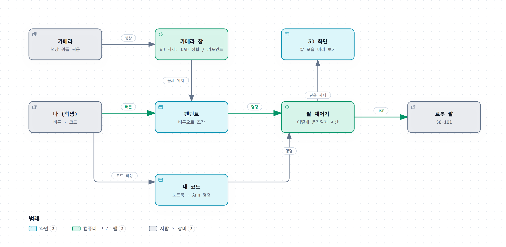
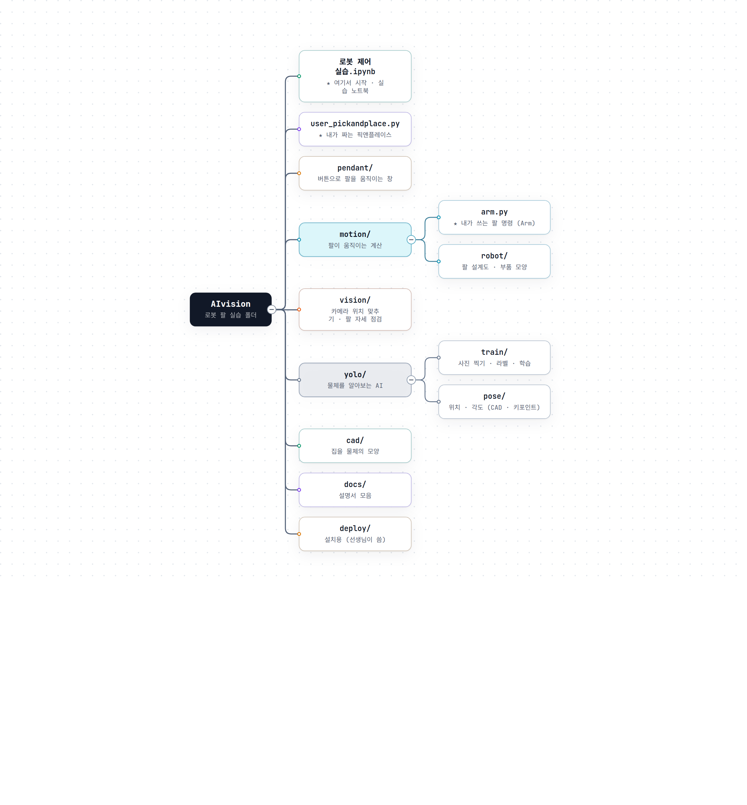

# 1. 교육 개요

## 1.1 교육 목표

이 수업이 끝나면 학생은 다음을 할 수 있다.

1. **팔을 움직인다.** 리더 팔로 직접 움직여 보고 (텔레오퍼레이션), 펜던트 버튼과 Python 코드 (`moveL`, `moveJ`) 로 그리퍼 끝을 원하는 좌표로 보낸다.
2. **카메라를 로봇에 맞춘다.** 손눈 캘리브레이션으로 카메라 좌표를 로봇 좌표로 바꾸는 "번역표" 를 만들고, 맞았는지 숫자와 팔 끝으로 직접 검증한다.
3. **물체를 알아보고 6D 자세를 구한다.** 사진 20장으로 인식 모델을 학습시키고, 브라켓의 위치와 방향을 **두 가지 방식 (① CAD 정합, ② 키포인트)** 으로 구해 비교한다.
4. **보고 집는다.** 카메라가 찾은 브라켓을 집어 옮기고, 흰 브라켓에 마커로 표시한 **불량**을 가려낸다.

## 1.2 대상과 전제

- 로봇을 거의 처음 다루는 사람. 로봇 · 좌표 · 딥러닝 용어를 모른다고 가정한다.
- Python 수준은 모른다. 노트북 칸을 위에서부터 실행하는 법부터 알려 준다 (4장).
- 수학은 "x · y · z 좌표" 와 "각도" 정도만 쓴다. 행렬 · 미분은 꺼내지 않는다.

## 1.3 시간표 (8차시 × 60분, 점심 별도)

오전은 팔 다루기와 카메라 맞추기, 오후는 인식 · 자세 → 좌표로 집기 → 보고 집기. 쉬는 시간은 따로 두지 않는다 (실습 중에 자연스럽게 쉰다).

| 차시 | 주제 | 핵심 활동 |
|---|---|---|
| 1 | 시작과 로봇팔 구조 | 안전 → **텔레오퍼레이션 체험** → 관절 · 리더와 팔로워 |
| 2 | 좌표와 자세 | 베이스 좌표 · TCP · xyz · rpy, 펜던트로 움직이기 |
| 3 | 코드로 움직이기 | 노트북 1~7절, 가상 팔 → 실기 |
| 4 | 카메라와 손눈 캘리브 + 검증 | 왜 캘리브하나, 보드 사진 · 계산, **검증 3단계** |
| | 점심 | |
| 5 | 물체 인식 (YOLO) + ① 박스 라벨 | 사진 20장, 박스 직접 라벨, 기본 모델 위에 학습 |
| 6 | 6D 자세 추정, 두 가지 방식 | 키포인트 라벨 (`m` 자동), CAD 정합 결과, `k` 로 비교 |
| 7 | 좌표 적어서 집고 놓기 | 10단계, 블록 옮기기 미션 |
| 8 | 보고 집기와 응용 | 잡는 자세 가르치기, 카메라로 집기, **불량 검사**, 순서 짜기 |

순서를 이렇게 둔 이유:
- 손눈 캘리브는 팔을 여러 자세로 움직여야 해서 펜던트 · 코드를 배운 뒤 (2 · 3차시 뒤) 에 둔다. 그리고 점심 전에 끝내 오후를 카메라 작업에 쓴다.
- 좌표로 집기 (7차시) 를 보고 집기 (8차시) 바로 앞에 두면 "좌표를 손으로 적기 → 카메라가 좌표를 찾아 주기" 로 이어진다.
- 7차시는 카메라 · 학습이 필요 없다. 학습이 오래 걸리면 7차시를 먼저 하고 6차시 뒷부분을 뒤로 미룬다.

## 1.4 장비 구성

### 학생 한 명당 (8대 기준)

| 장비 | 설명 |
|---|---|
| Jetson Orin Nano 보드 | 모든 프로그램이 이 안에서 돈다. 환경 이름 `AIvision` |
| SO-101 7축 팔로워 | 모터로 움직이는 팔. 그리퍼 포함 |
| SO-101 리더 팔 | 손으로 잡고 움직이는 팔 (1차시 텔레오퍼레이션) |
| Orbbec 카메라 | 컬러 + 깊이. 책상 위를 내려다보게 고정 (받침을 건드리면 손눈 캘리브를 다시 해야 한다) |
| 모니터 · 키보드 · 마우스 | |
| 브라켓 | 흰 · 검은 브라켓 여러 개 (40 × 35 mm L 자, 양쪽 삼각 리브) |
| 블록 | 7차시 좌표 집기 미션용 |
| ChArUco 보드 | 4차시 손눈 캘리브용 (팔 끝에 붙여 찍는 보드) |
| 자 | 4차시 검증 ③ (팔 끝과 보드 코너 사이 거리 재기) |

### 강의실 전체

- 강사 보드 1대 (학생 보드와 같은 구성, 시연용. 박스 가중치가 있어 카메라 창이 바로 켜지는 상태)
- 마커펜 (검은색, 흰 브라켓에 불량 표시용)
- 예비 자료 (2.1절): 검증을 통과한 예비 손눈 캘리브, 예비 박스 가중치, 예비 장면
- 프로젝터 · 화면 공유

## 1.5 오늘 쓰는 프로그램 한눈에

바탕화면 **「AIvision 터미널」** 아이콘을 열면 터미널이 4칸으로 열린다 (모두 `AIvision` 환경).

| 칸 | 폴더 | 여기서 켜는 것 |
|---|---|---|
| 왼쪽 위 | `pendant` | 펜던트 (`python main.py`, 픽앤플레이스는 `--grasp`) |
| 오른쪽 위 | `vision` | 카메라 확인 · 손눈 캘리브 (`python handeye/…`) |
| 왼쪽 아래 | `yolo` | 사진 · 라벨 · 학습, 카메라 창 (`python pose/roi_cloud.py`) |
| 오른쪽 아래 | `AIvision` | 그 밖의 명령 (텔레오퍼레이션 등) |

| 프로그램 | 무엇 | 언제 |
|---|---|---|
| 텔레오퍼레이션 | 리더 팔로 팔로워 움직이기 | 1차시 |
| 펜던트 | 버튼으로 팔 움직이기, 물건 칸 (`--grasp`) | 2 · 4 · 8차시 |
| 3D 화면 (Meshcat) | 브라우저에 보이는 가상 팔 | 2 · 3 · 8차시 |
| 노트북 (Jupyter) | `로봇 제어 실습.ipynb`, 코드로 팔 움직이기 | 3 · 7 · 8차시 |
| 손눈 캘리브 도구 | `vision_test` · `get_intrinsic` · `capture` · `compute` · `compare_pnp_depth` | 4차시 |
| 라벨 도구 두 개 | 박스 (`label.py`), 키포인트 (`kpt_label.py`) | 5 · 6차시 |
| 카메라 창 | 6D 자세 (`k` 로 방식 바꾸기, `i` 검사) | 6 · 8차시 |

같은 팔을 두 프로그램이 동시에 쓸 수 없다. **펜던트 · 노트북 · 텔레오퍼레이션 중 하나만** 켠다 (카메라 창은 팔을 쓰지 않으므로 같이 켜도 된다).

## 1.6 전체 그림

`docs/diagrams/index.html` 을 브라우저로 연다 (`google-chrome docs/diagrams/index.html`). 수업 중 화면에 띄워 쓰면 좋다.

| 그림 | 언제 쓰나 |
|---|---|
| 1 폴더 둘러보기 | 1차시 오리엔테이션 (★ 표시가 학생이 직접 여는 파일) |
| 2 로봇 팔은 어떻게 움직이나요? | 2 · 3차시 (펜던트와 코드가 같은 팔 제어기로 간다) |
| 3 **6D 자세 추정: 두 가지 방식** | 6차시 (CAD 정합 / 키포인트가 갈라졌다 합쳐지는 그림) |
| 4 픽앤플레이스 한눈에 보기 | 8차시 |
| 5 집어서 옮기는 10단계 | 7차시 |

## 1.7 이 가이드 읽는 법

- 3장 (차시별 진행) 이 본체다. 차시마다 같은 순서로 쓴다:
  목표와 시간 배분 → 설명할 것 → 시연 순서 → 학생이 칠 명령 → 잘 되면 보이는 화면 → 자주 막히는 곳 → ⏱ 시간 조절
- 표시
  - **설명할 것**: 그 차시에 꼭 전달할 내용의 요점. 말하는 방식은 강사에게 맡긴다.
  - ⚠ : 안전 · 장비 손상과 관련된 주의
  - ⏱ : 시간이 모자랄 때 줄이는 법, 남을 때 더 하는 것
  - ★ : 시간이 모자라면 먼저 뺄 활동
  - **[실물 확인]** : 실물 보드에서 아직 확인하지 못한 화면 · 숫자. 납품 보드로 수업 전에 한 번 확인한다.
- 학생용 명령 정리는 `docs/실행 코드.md` (바탕화면에도 있다), 노트북 정리는 `docs/노트북 실습.md` 다. 이 가이드의 명령은 그 문서와 같다.
- 명령은 **오른쪽 아래 칸 (AIvision 폴더)** 기준으로 적는다. 다른 칸에서는 앞의 폴더 이름을 뺀다 (예: `python pendant/main.py` → 왼쪽 위 칸에서 `python main.py`).
