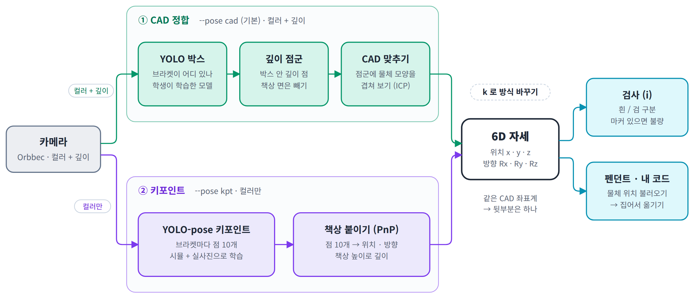

# 3.6 6차시 — 6D 자세 추정, 두 가지 방식 (60분)

## 목표

- 6D 자세 (위치 x · y · z + 방향 Rx · Ry · Rz) 가 무엇인지 안다.
- 6D 자세를 구하는 **두 가지 방식** — ① CAD 정합, ② 키포인트 — 의 원리와 차이를 안다.
- 키포인트 라벨을 달고 (처음 2~3장 직접, 그다음 자동) 학습시킨다.
- 카메라 창에서 `k` 로 두 방식을 번갈아 보며 비교한다.

그림: `docs/diagrams/pose/pose.html` (6D 자세 추정: 두 가지 방식). 이 차시 내내 화면에 띄워 둔다.

## 시간 배분

| 분 | 활동 | 명령 |
|---|---|---|
| (5차시 끝) | 6D 자세 · 두 방식 개념 | PPT 6차시 2~5 |
| 0–15 | ② 키포인트 라벨 (2~3장 직접 → `m` 자동) | `kpt_label.py` |
| 15–20 | ② 학습 시작 | `kpt_train.py` |
| 20–45 | ① CAD 정합 결과 보기 | `roi_cloud.py`, `v` |
| 45–60 | `k` 로 두 방식 비교, 기록표, 정리 | `roi_cloud.py` |

## 개념 (5차시 학습 동안 또는 이 차시 첫머리)

**설명할 것**
- 박스만으로는 못 집는다. **어디에** (x · y · z), **어느 방향으로** (Rx · Ry · Rz) = **6D 자세**
- **① CAD 정합**: 박스 안 깊이 점들을 3D 로 (점군) → 책상 면 빼기 → 설계도 (CAD) 모양을 돌려 가장 잘 겹치는 자리. 높이가 정확하지만 깊이 잡음에 흔들림
- **② 키포인트**: 컬러 사진에서 정해진 점 10개 → 그 점들이 찍힌 모습으로 위치 · 방향 계산. 사진만 쓰고 빠르지만 책상 위에 놓였다고 가정
- 두 방식 모두 같은 설계도 좌표로 답을 내므로 검사 · 집기는 똑같이 쓴다

PPT 6차시 3: 두 방식 그림 (`pose.html` 캡처). 4 · 5: 각 방식의 단계 그림.



## 0–15 ② 키포인트 라벨

5차시에 찍은 같은 사진에 이번에는 **점** 을 찍는다. 라벨은 박스 라벨과 따로 저장된다 (`yolo/datasets/raw/kpt_labels/`).

```bash
python train/kpt_label.py
```

### 처음 2~3장: 직접 찍기

**설명할 것**
- 오른쪽 위 안내 그림의 번호대로 0번부터 클릭 (찍으면 다음 번호로). 가려진 점은 `h`. 8 · 9번은 안쪽 접힌 곳이라 자동
- 몇 개 찍으면 **하늘색 윤곽** (설계도) 이 나온다 → 실제 테두리와 맞으면 잘 찍은 것. `f` = 윤곽을 테두리에 자동으로 붙이기
- 번호를 어느 쪽부터 찍어도 저장할 때 규칙에 맞게 다시 매겨진다

### 그다음: `m` 으로 자동 찍기

**설명할 것**
- `m` → 「자동 찍기 켜짐」: 사진을 열면 모델이 점을 찍고 윤곽까지 맞춘다
- 학생은 **윤곽이 실물과 맞는지만** 보고 `n`. 틀린 점만 끌어서 옮긴다

| 키 | 하는 일 |
|---|---|
| `m` | 자동 찍기 켜기 / 끄기 |
| 클릭 · 끌기 | 지금 번호 점 찍기 · 점 옮기기 |
| `0`~`9` | 번호 고르기 |
| `h` | 이 점은 가려짐 |
| `f` | 테두리 자동 맞춤 |
| `k` | 자세 종류 바꾸기 (같은 자리에서 다른 자세로 놓아 보고 가장 잘 맞는 것) |
| `a` · `Tab` · `D` | 브라켓 추가 · 다음 브라켓 · 브라켓 삭제 |
| `u` 또는 우클릭 | 되돌리기 |
| `s` · `n` / `p` · `q` | 저장 · 다음 / 이전 (저장) · 저장 후 끝 |

> 자동 찍기는 라벨을 "검수" 하는 일로 바꿔 줍니다. 20장이 10~20분 안에 끝난다.

## 15–20 ② 학습 시작

⚠ 카메라 창 · 브라우저 · 노트북을 끄고.

```bash
python train/kpt_train.py
```

5차시 박스 학습과 같은 방법이다: 기본 키포인트 모델 (`kpt_base.pt`) 에서 시작, 학생 사진 10번 반복 + 키포인트 섞음 세트 300장, 15 에폭. 첫 줄:
```
학생 사진 n장 (×10) + 섞음 300장 → 학습 … · 검증 …
```
노트북 RTX 약 4분, **젯슨 [실물 확인]**. 끝나면 `yolo/weights/kpt_best.pt` 가 생기고, 카메라 창의 키포인트 방식과 라벨 도구의 자동 찍기가 이 모델을 쓴다. 카메라 창의 키포인트 방식은 이 모델이 생겨야 켜진다 (기본 모델로 대신하지 않는다).

근거 (노트북 시험): 섞음 없이 10번 반복하면 학습에 안 쓴 시뮬 장면 150개 중 118개만 맞혔다 (기본 모델 150). 섞으면 149.

## 20–45 ① CAD 정합 결과 보기

### ① CAD 정합은 이렇게 맞춘다

**설명할 것** (PPT 6차시 4)
1. **찾기** — 5차시에 학습한 박스 모델이 브라켓에 네모를 친다.
2. **3D 로** — 네모 안 픽셀마다 깊이를 읽어 3D 점으로 만들고, 로봇 좌표로 옮긴다. 4차시의 내부 파라미터 공식과 손눈 캘리브 결과 (`T_base_cam`) 를 그대로 쓴다.
3. **책상 빼기** — 가장 넓은 평면 (책상) 을 찾아 그보다 높은 점만 남긴다. 남은 점 = 브라켓 표면. 책상을 잘못 찾았으면 카메라 창에서 `r`.
4. **설계도 대 보기** — 설계도 (CAD) 를 세 자세 (세우기 · 눕히기 · 비스듬히) × 15° 마다 돌려 책상 위에 놓아 보고, 조금씩 밀고 돌려 점들과 가장 잘 겹치는 후보 3개를 남긴다. 이렇게 겹쳐 맞추는 방법을 **ICP** 라고 한다.
5. **촘촘히** — 1등 후보를 1 mm 간격 점으로 한 번 더 맞춘다. 그 위치 · 방향이 6D 자세.

- 비유: **퍼즐 조각 (설계도) 을 사진 속 빈자리 (점군) 에 돌려 가며 끼워 보는 것.**
- 학습하는 것은 1번 (박스) 뿐이다. 2~5번은 계산이라 학습이 필요 없다.
- 깊이에 기대므로, 깊이가 비거나 (반사 · 검은 표면) 흔들리면 잘 안 맞는다 → 「CAD miss」.
- 책상 위 세 자세로 안 맞으면 (기대거나 쌓인 경우) 다른 방법으로 한 번 더 맞춰 본다.
- 카메라 창은 **맨 위 브라켓** (펜던트로 집을 것) 을 먼저 맞추고, 나머지 브라켓은 이어서 맞춘다.

### 결과 보기

학습이 도는 동안 (메모리가 모자라면 학습이 끝난 뒤) 카메라 창을 켠다. 브라켓 2~3개를 **책상 위에, 3 cm 이상 떨어뜨려** 놓는다.

```bash
python pose/roi_cloud.py          # 자세 방식 ① CAD 정합 (기본)
```

화면 읽는 법:
- 왼쪽 컬러, 오른쪽 깊이. 브라켓마다 박스와 자세 이름.
- 브라켓마다 **하늘색 윤곽과 축 (빨강 X · 초록 Y · 파랑 Z)**: 맞춘 CAD 의 자세.
- 위쪽 노란 줄: 맨 위 브라켓의 `물체 x · y · z` (mm), `Rx · Ry · Rz` (도). 펜던트로 집을 때 쓰는 숫자.
- 그 아래 `[CAD 정합] … 외 n개 (k=키포인트)`.

`v` 를 누르면 Open3D 창에 맨 위 브라켓의 **점군과 겹친 CAD** 가 3D 로 보인다 (마우스로 돌려 보기).

**설명할 것**
- `v` 화면의 점들 = 깊이 카메라가 잰 브라켓 표면, 겹친 모양 = 설계도. 둘을 가장 잘 겹치는 위치 · 방향이 6D 자세

## 45–60 `k` 로 두 방식 비교

⚠ 카메라 창은 켤 때 키포인트 모델 (`kpt_best.pt`) 을 읽는다. 20분에 학습 중에 켠 창이면 **`q` 로 끄고 학습이 끝난 뒤 다시 켠다.** 그러지 않으면 `k` 에서 「키포인트 방식을 쓸 수 없습니다」 가 뜬다.

카메라 창에서 **`k`** 를 누를 때마다 ① CAD 정합 ↔ ② 키포인트. 위쪽 줄이 `[키포인트] 브라켓 n개 … ms/장` 으로 바뀌고, 브라켓마다 윤곽이 키포인트 방식으로 다시 그려진다.

활동: 같은 브라켓을 두 방식으로 보고 부록 8.6 「6차시 비교표」 에 적는다.

| 브라켓 | ① x · y · Rz | ② x · y · Rz | 차이 |
|---|---|---|---|
| 흰 세우기 | | | |
| 검은 눕히기 | | | |

**설명할 것**
- 두 방식의 숫자가 몇 mm · 몇 도 안으로 비슷하면 둘 다 잘 된 것
- 크게 다르면 윤곽이 실물 테두리와 맞는 쪽이 맞다

두 방식 비교 (PPT 6차시 10, 그림 카드):

| | ① CAD 정합 | ② 키포인트 |
|---|---|---|
| 쓰는 것 | 컬러 + 깊이 | 컬러만 |
| 강점 | 깊이를 직접 재서 높이가 정확, 학습할 것이 박스 하나 | 빠르고 여러 개를 한 번에, 깊이 잡음과 상관없음 |
| 약점 | 깊이 잡음에 약함, 한 개 맞추는 데 수 초 | 책상 위에 놓였다고 가정 |

시뮬 비교 (브라켓 3개씩, 떨어뜨려 놓음): 깊이 잡음이 없으면 둘 다 모두 맞음. 실물 같은 잡음이 있으면 ① 은 맨 위 1개는 항상 맞고 나머지는 3개 중 1~2개, ② 는 모두 맞음.

### 놓는 조건 (두 방식 공통)

- 브라켓은 **책상 위에** 세 자세 중 하나로.
- 서로 **3 cm 이상** 떨어뜨린다 (붙어 있으면 서로 가리고 박스 안에 옆 브라켓 점이 섞인다).
- **쌓거나 기대 놓으면 두 방식 모두 자세가 틀린다** (시뮬 더미 시험에서 0~2%).

### 잘 되면

- 두 방식 모두 브라켓마다 윤곽이 실물 테두리에 겹친다.
- 같은 브라켓의 x · y 가 두 방식에서 몇 mm 안으로 비슷하다.

### 자주 막히는 곳

| 증상 | 원인 | 해결 |
|---|---|---|
| 카메라 창이 「가중치 없음」 으로 안 켜짐 | 5차시 학습이 안 끝남 | 학습 끝날 때까지 기다리거나 예비 박스 가중치 |
| `k` 를 눌러도 「키포인트 방식을 쓸 수 없습니다」 | 키포인트 학습이 아직 안 끝남 (`kpt_best.pt` 없음) | `kpt_train.py` 가 끝난 뒤 카메라 창을 다시 켠다 (5.5) |
| 라벨 도구가 「박스 라벨이 있습니다」 로 멈춤 | `--labels` 로 박스 라벨 폴더를 줌 | 옵션 없이 `python train/kpt_label.py` (5.4) |
| 하늘색 윤곽이 실물과 1 cm 넘게 어긋남 | 손눈 캘리브가 틀림 | 4차시 기록표 확인, 검증 ② 다시 (5.3) |
| 한 브라켓만 윤곽이 엉뚱함 | 붙어 있음 · 화면 가장자리 · 기대 놓음 | 떨어뜨려 · 화면 안쪽으로 · 책상에 바로 (5.5) |
| ① 이 「CAD miss」 를 반복 | 깊이가 비어 있음 (반사 · 검은 물체) | `c` 로 다시, 브라켓 위치 바꾸기, `r` 책상 다시 찾기 |

## ⏱ 시간 조절

- 모자라면: 키포인트 라벨을 10장으로 (2~3장 직접 + 7장 자동). `v` 3D 보기는 강사 시연으로.
- 학습이 오래 걸리면: 7차시를 먼저 하고 45–60 비교를 7차시 뒤에.
- 남으면: 일부러 브라켓 두 개를 붙여 놓거나 기대 놓고 두 방식이 어떻게 틀리는지 보기 (왜 3 cm 를 띄우는지).
