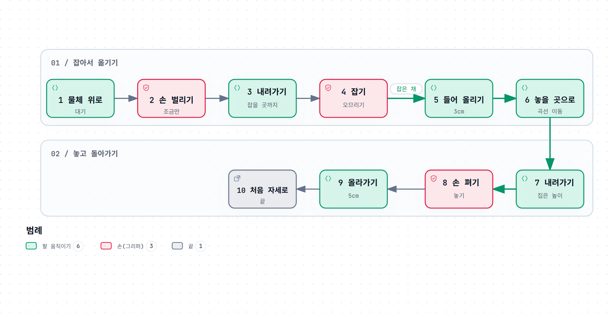

# 3.7 7차시 — 좌표 적어서 집고 놓기 (60분)

## 목표

- 물건을 집어 옮기는 순서 (접근 → 내려가기 → 잡기 → 올리기 → 옮기기 → 놓기 → 빠지기) 를 안다.
- 좌표를 직접 적어 블록을 옮긴다 (카메라 없이).
- ★ 오류 메시지를 읽고 원인을 찾는다.

이 차시는 카메라 · 학습이 필요 없다. 6차시 학습이 오래 걸리면 이 차시를 먼저 한다.

## 시간 배분

| 분 | 활동 | 화면 |
|---|---|---|
| 0–20 | 집어서 옮기는 순서 | 그림 「집어서 옮기는 10단계」, 노트북 8절 |
| 20–50 | 미션: 블록 옮기기 | 노트북 8-2 |
| 50–60 | ★ 오류 읽는 법 | 노트북 8-3, 부록 8.4 |

노트북은 1 · 2절을 실행한 다음 8절로 건너뛴다 (3~7절은 3차시에 했다). 빈칸본을 쓰면 8절 · 8-2 에 `# 빈칸채우기` 줄이 있다.

## 0–20 집어서 옮기는 순서

그림 `docs/diagrams/tensteps/tensteps.html` 을 띄운다.



**설명할 것**
- 사람이 컵을 옮길 때와 같은 순서: 위로 → 손 벌리기 → 내려가기 → 쥐기 → 들기 → 옮기기 → 내려놓기 → 손 펴기 → 빼기
- **바로 내려가지 않는다**: 먼저 물건 **위** (대기 위치) 로 가서 곧게 내려간다 (옆에서 부딪히지 않게)

| 단계 | 하는 일 | 코드 예 |
|---|---|---|
| 1 | 물체 위로 (대기 위치) | `arm.moveL([x, y, z + 40], "abs")` |
| 2 | 손 벌리기 | `arm.grip(100)` |
| 3 | 잡을 곳까지 내려가기 | `arm.moveL([0, 0, -40], "rel")` |
| 4 | 잡기 | `arm.grip(0)` |
| 5 | 들어 올리기 | `arm.moveL([0, 0, 50], "rel")` |
| 6 | 놓을 곳으로 | `arm.moveL([0, 80, 0], "rel")` |
| 7 | 내려가기 | `arm.moveL([0, 0, -40], "rel")` |
| 8 | 손 펴기 | `arm.grip(100)` |
| 9 | 올라가기 | `arm.moveL([0, 0, 40], "rel")` |
| 10 | 처음 자세로 | `arm.home()` 또는 `arm.initial()` |

노트북 8절이 이 순서다 (가상 팔로 먼저):
```python
arm.initial()
arm.grip(100)
arm.moveL([0, 0, -40], "rel")
arm.grip(0)
arm.moveL([0, 0, 50], "rel")
arm.moveL([0, 80, 0], "rel")
arm.moveL([0, 0, -40], "rel")
arm.grip(100)
arm.moveL([0, 0, 40], "rel")
arm.home()
```

**설명할 것**
- 그리퍼 0 = 닫힘, 100 = 완전히 열림. 펴는 것은 반드시 내려놓은 다음 (공중에서 펴면 떨어진다)

## 20–50 미션: 블록 옮기기 (노트북 8-2)

1. 블록을 책상의 A 자리에 놓는다.
2. 2차시처럼 펜던트로 그리퍼 끝을 블록 바로 위에 맞추고 X · Y · Z 를 적는다 (또는 노트북 `arm.where()`). ⚠ 노트북과 펜던트는 동시에 쓰지 않는다 — 펜던트로 적은 뒤 끄고 노트북을 연다.
3. B 자리 (놓을 곳) 의 X · Y 도 같은 방법으로 적는다.
4. 노트북 8-2 의 첫 두 줄에 적은 A · B 좌표를 넣고 실행한다. **가상 팔로 먼저**, 강사 확인 뒤 실기 (3차시 실기 순서: 커널 재시작 → 1절을 `Arm(mode="real")` 로).

8-2 칸 (완성본, 숫자는 예시라 자리마다 다르다):
```python
ax, ay, az = 200, 50, 15                        # A: 블록을 집는 곳 (z 는 집는 높이)
bx, by = 180, -80                               # B: 놓는 곳

arm.initial()
arm.moveL([ax, ay, az + 40], "abs")             # A 위 40mm
arm.grip(100)                                   # 손 벌리기
arm.moveL([ax, ay, az], "abs", speed=10)        # 천천히 내려가기
arm.grip(0)                                     # 잡기
arm.moveL([ax, ay, az + 50], "abs")             # 들기
arm.moveL([bx, by, az + 50], "abs", path="joint")   # B 위로 (관절 이동)
arm.moveL([bx, by, az], "abs", speed=10)        # 천천히 내려가기
arm.grip(100)                                   # 놓기
arm.moveL([bx, by, az + 40], "abs")             # 빠지기
arm.initial()
```

빈칸본에서 채우는 곳: A · B 좌표 (자기가 적은 숫자), A 위 높이 `az + 40`, 잡기 `grip(0)`, `path="joint"`.

**설명할 것**
- 멀리 옮길 때 `path="joint"` (관절 이동이라 무리가 적다), 내려갈 때 `speed=10`

### 잘 되면

- 블록이 B 에 똑바로 놓인다.
- 실기에서도 가상과 같은 순서로 움직인다.

빠른 학생: 블록 두 개를 차례로 쌓기, 놓는 자리를 바꾸며 반복문으로.

## 50–60 ★ 오류 읽는 법 (노트북 8-3)

**설명할 것**
- 오류는 빨간 글씨의 **마지막 줄** 부터 읽는다. 무엇이 잘못됐는지 한국어로 쓰여 있다

일부러 틀려 보기 (가상 팔에서): 노트북 8-3 칸은 틀린 줄이 모두 `#` 로 꺼져 있다. **한 번에 한 줄만** `#` 을 지우고 실행하고, 메시지를 읽은 뒤 다시 `#` 을 붙인다.

| 실수 | 코드 (8-3) | 메시지 (마지막 줄) | 원인 |
|---|---|---|---|
| mode 빠뜨림 | `arm.moveL([30, 0, 0])` | `TypeError: Arm.moveL() missing 1 required positional argument: 'mode'` | `"rel"` / `"abs"` 를 꼭 |
| 순서 바뀜 | `arm.moveL("abs", [200, 0, 80])` | `ArmError: moveL의 두 번째 인자는 'abs' 또는 'rel' 이어야 합니다` | 좌표 먼저, mode 다음 |
| 숫자 개수 | `arm.moveL([30, 0], "rel")` | `ArmError: xyz는 mm 3개입니다` | x · y · z 세 개 |
| 속도 범위 밖 | `arm.moveL([30, 0, 0], "rel", speed=100)` | `ArmError: speed는 5–45 mm/s 입니다` | `moveL` 5~45, `moveJ` 8~45 |
| 끈 팔에 명령 | 10절 `arm.close()` 뒤 다른 칸 | `ArmError: 이미 종료된 Arm 입니다` | 다시 1절부터 |

**말로만 짚을 것** (8-3 에 넣지 않았다. 가상 팔에서 오류가 늦게 나거나 안 난다)
- 닿지 않는 좌표 `[800, 0, 100]`: 1분쯤 기다린 뒤 `목표까지 … mm 남음 (도달 못함)` 이 나거나, 오류 없이 닿는 데까지만 가서 멈춘다.
- 상대를 절대처럼 `moveL([200, 0, 80], "rel")`: 오류 없이 닿는 데까지만 간다.
- rpy 를 더하는 값으로 `rpy=[0, 0, 10]`: 목표 자세 (0, 0, 10) 로는 못 가고, 오류 없이 거의 그대로 멈춘다.
- ⚠ **mm 대신 m** `[0.2, 0.0, 0.08]`: 가상 팔은 오류 없이 **베이스 한가운데** 로 간다. 실기에서는 절대 해 보지 않는다. 실행 전에 숫자를 짝과 읽는 이유다.

→ 오류가 안 났다고 맞는 코드는 아니다. 실행 뒤 `where()` 로 정말 그 자리인지 본다.

전체 목록은 부록 8.4 와 `docs/교육용_API_명세.md` 7절.

## ⏱ 시간 조절

- 모자라면: 미션을 노트북 8절 그대로 실기로 돌려 보는 것으로. 오류 읽기는 표만 보여 주기. 빈칸본이면 8-2 는 완성본으로 바꿔 좌표만 고친다.
- 남으면: "높이가 다른 두 곳 (책 위 · 책상 위) 사이 옮기기" — 놓는 높이를 바꿔야 한다.
