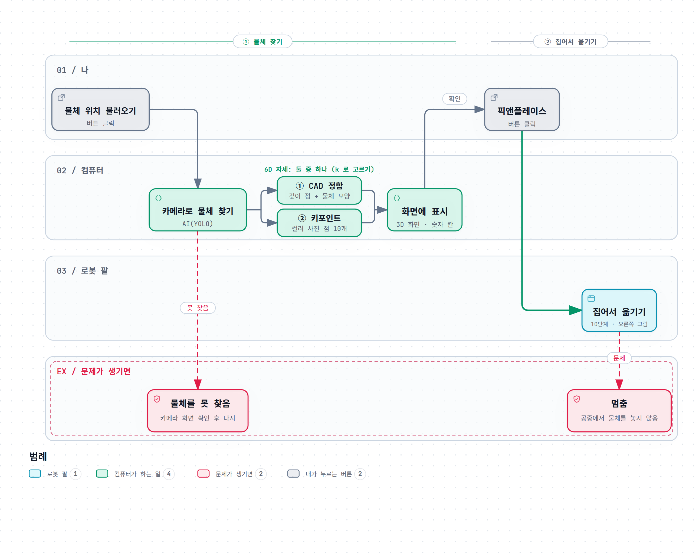

# 3.8 8차시 — 보고 집기와 응용 (60분)

## 목표

- 물체의 어디를, 어느 방향에서 잡을지 (대기 · 집기 자세) 를 정하는 법을 안다.
- 카메라가 찾은 브라켓을 집어 옮긴다 (펜던트 버튼, 노트북 코드).
- 흰 브라켓의 마커 **불량** 을 카메라 창 `i` 로 가려낸다.
- 여러 브라켓을 어떤 순서로 집을지 코드로 정하고, 불량 · 양품을 접시에 나눠 놓는다.

## 시간 배분

| 분 | 활동 | 화면 |
|---|---|---|
| 0–10 | 잡는 자세 가르치기 | 펜던트 `--grasp` 물건 칸 |
| 10–35 | 전체 연결: 카메라 → 픽앤플레이스 | 카메라 창 + 펜던트, 노트북 9절 |
| 35–50 | 불량 검사 | 카메라 창 `i` |
| 50–60 | 응용: 집는 순서 · 불량 · 양품 나누기 · 정리 | 노트북 9-2 · 9-3 |

## 0–10 잡는 자세 가르치기

왼쪽 위 칸:
```bash
python main.py --grasp
```
펜던트 아래쪽에 **물건 칸** (사물의 위치 x · y · z · Rx · Ry · Rz) 이 생기고, 3D 화면에 브라켓 모양과 접근 점 (대기 · 집기) 이 함께 그려진다.

**설명할 것**
- 자세를 알아도 "어디를, 어느 쪽에서 잡을지" 는 따로 정해야 한다
- 프로그램이 CAD 를 보고 손가락이 들어갈 면 · 방향을 고르고, **대기 위치** 와 **집기 위치** 를 계산한다
- **d** = 표면 → 대기 위치 거리, **a** = 대기 → 집기 위치로 들어가는 거리

시연 · 실습 (가상 팔로 충분):
1. **물체 랜덤 생성** → 책상 위 무작위 자리 · 자세에 브라켓이 놓인다.
2. 3D 화면의 대기 · 집기 점과 축을 본다.
3. **대기 위치로** → **집기 위치로** 를 차례로 눌러 그리퍼가 어떻게 들어가는지 본다.
4. d · a 를 바꿔 보고 다시 (예: a 를 줄이면 덜 깊게 쥔다).
5. 자세 종류 (세우기 · 눕히기 · 비스듬히) 를 바꿔 가며 랜덤 생성 → 자세마다 잡는 방향이 다른 것을 본다.

⚠ 실기로 **집기 위치로** 를 누를 때는 책상 위에 실제 브라켓을 같은 자리에 두거나, 빈 책상에서 천천히.

## 10–35 전체 연결: 카메라 → 픽앤플레이스

그림 `docs/diagrams/pickplace/pickplace.html` 을 띄운다 (가운데가 ① CAD 정합 / ② 키포인트 두 갈래).



### 펜던트로

1. 왼쪽 아래 칸에서 카메라 창: `python pose/roi_cloud.py` (② 로 하려면 `--pose kpt` 또는 창에서 `k`).
2. 왼쪽 위 칸에서 펜던트: `python main.py --grasp` → **Connect**.
3. ⚠ 불러오기 전에 팔을 **초기자세** 로 치운다 (카메라가 그리퍼 끝을 물체로 잘못 볼 수 있다).
4. **물체 위치 불러오기** → 카메라 창이 지금 방식의 자세를 보내 물건 칸이 채워진다 (3~5초).
5. **픽앤플레이스** → 10단계로 집어 「놓기 x / y」 자리에 내려놓는다 (3D 화면 바닥의 빨간 원).

물체를 쥔 동안 (4~8단계) 위쪽에 「물체 쥠」 이 보인다. 쥔 채 문제가 생기면 팔이 그 자리 아래로 천천히 내려가 내려놓고 멈춘다. 그것도 안 되면 쥔 채로 멈춘다 → 손으로 받치고 **Gripper Open**.

### 노트북으로 (9절)

⚠ 펜던트를 끄고 노트북을 연다 (카메라 창은 켜 둔다).
```python
drop_x, drop_y = 150.0, -100.0
pick = load_pick_targets(arm)        # 카메라 창에 요청, 대기 · 집기 자세를 받음
z_g = pick.g_xyz[2]

arm.initial()
arm.moveL(pick.p_xyz, "abs", rpy=pick.p_rpy)     # 대기
arm.grip(30)
arm.moveL(pick.g_xyz, "abs", rpy=pick.g_rpy)     # 집기
arm.grip(0)
arm.moveL([0, 0, 30], "rel")
arm.moveL([drop_x, drop_y, z_g + 50], "abs", rpy=pick.place_rpy, path="joint")
arm.moveL([drop_x, drop_y, z_g], "abs", rpy=pick.place_rpy)
arm.grip(30)
...
```

**설명할 것**
- 7차시에 손으로 적던 좌표를 `load_pick_targets` 가 카메라에게 물어 채워 준다. 순서는 7차시와 같다

활동: 두 방식으로 한 번씩 (카메라 창에서 `k`) 집어 보고 둘 다 성공하는지.

### 자주 막히는 곳

| 증상 | 원인 | 해결 |
|---|---|---|
| 「카메라 창이 응답하지 않습니다」 | 카메라 창이 꺼짐 · 30초 안에 못 끝냄 | 카메라 창 켜기, 브라켓이 화면에 보이는지 (5.2) |
| 「바운딩 박스가 없습니다」 | 화면에 브라켓이 없음 · 못 찾음 | 브라켓 위치, 팔을 화면 밖으로 |
| 집기가 한 방향으로 일정하게 빗나감 | 손눈 캘리브 | 4차시 기록표, 검증 ② 다시 (5.3) |
| 집기가 들쭉날쭉 빗나감 | 자세 추정 흔들림 | 다른 방식 (`k`) 으로, 브라켓을 떨어뜨려 (5.5) |
| 그리퍼가 브라켓에 부딪힘 | 잡는 방향 · d · a | 물건 칸에서 대기 · 집기 위치를 먼저 확인 |

## 35–50 불량 검사

**설명할 것**
- 집기 전에 불량인지 본다. 여기서는 흰 브라켓의 마커 표시 = 불량
- 학습이 아니라 **규칙**: 자세를 알면 사진에서 브라켓 영역을 정확히 안다 → 그 안 (구멍 제외) 의 어두운 점 수를 센다 → 흰 브라켓인데 많으면 불량

1. 흰 브라켓 하나에 마커 표시 (2.1 에서 준비한 것), 흰 양품 · 검은 브라켓도 같이 놓는다 (3 cm 이상 떨어뜨려).
2. 카메라 창에서 **`i`** → 화면이 멈추고 판정이 그려진다. 아무 키나 → 다시.

| 윤곽 색 | 판정 |
|---|---|
| 초록 | 양품 |
| 빨강 | 불량 (마커 점은 빨갛게 칠해진다) |
| 보라 | 검사 안 함 (검은 브라켓은 마커가 안 보여 검사하지 않는다) |
| 주황 | 브라켓 아님 (윤곽이 사진 테두리와 안 맞음) |

터미널에는 표가 나온다: 브라켓마다 자세 · 색 · 판정 · 어두운 픽셀 수 · 펜던트에 넣을 xyz · RPY.

`i` 는 두 방식 모두 된다 (`k` 로 바꾼 뒤 `i`). 판정 규칙은 같고 자세만 다르다.

### 자주 막히는 곳

| 증상 | 원인 | 해결 |
|---|---|---|
| 마커를 했는데 양품 | 마커가 너무 작음 · 연함 · 구멍 바로 옆 | 진하게, 5 mm 이상, 판 가운데 |
| 양품인데 불량 | 그림자 · 케이블 · 윤곽이 어긋남 | 브라켓을 케이블에서 떨어뜨림, 윤곽이 맞는지 확인 (5.5) |
| 검은 브라켓이 판정 안 됨 | 정상 (검사 안 함) | |

## 50–60 응용: 집는 순서 · 정리 (노트북 9-2 · 9-3)

**설명할 것**
- 여러 개면 무엇부터? 정답은 없고, 규칙을 정하는 것도 프로그램
- 흔한 규칙: 불량부터, 가까운 것부터, **한 개 집을 때마다 다시 보기** (집다가 다른 것이 밀릴 수 있다)

`load_all_pick_targets(arm)` 은 보이는 브라켓을 모두, 자세 · 색 · 판정 · 집기 좌표와 함께 **가까운 순** 으로 준다. 노트북 9-2 (카메라 창은 켜 둔다):

```python
from motion import load_all_pick_targets

objs = load_all_pick_targets(arm)
for o in objs:
    print(o.verdict, o.color, o.pose, o.xyz, o.distance)

# 불량 먼저, 그다음 가까운 것부터
order = sorted(objs, key=lambda o: (o.verdict != "불량", o.distance))
print([o.verdict for o in order])
```

빈칸본에서 채우는 곳: `o.verdict != "불량"` 의 `"불량"`.

### 미션: 불량 · 양품 나누기 (노트북 9-3)

**책상 배치** (카메라 화면 기준)

| 자리 | 놓는 것 |
|---|---|
| 화면 왼쪽 절반 | 브라켓 (흰 양품 · 흰 불량 · 검은 것, 3 cm 이상 떨어뜨려) |
| 화면 오른쪽 위 | 작은 접시: **불량** |
| 화면 오른쪽 아래 | 작은 접시: **양품** |

- 화면 위 = 로봇 +X (먼 쪽), 화면 왼쪽 = 로봇 +Y. 그래서 왼쪽 절반은 `o.xyz[1] > 0` 이다 (4차시 카메라 축).
- 접시에 놓은 브라켓은 화면 오른쪽에 있어서 다시 집지 않는다.
- 수업 전에 펜던트 (또는 `arm.where()`) 로 그리퍼 끝을 두 접시 가운데에 맞춰 X · Y 를 재 둔다. 코드의 `(230, -150)` · `(110, -150)` 은 예시다.
- 놓는 높이는 집은 높이보다 30 mm 위다. 접시 테두리가 그보다 높으면 `z_g + 30` 을 키운다.

9-3 칸 (완성본):
```python
from motion import ArmError, load_all_pick_targets

BAD_DISH = (230, -150)                          # 불량 접시 (화면 오른쪽 위)
GOOD_DISH = (110, -150)                         # 양품 접시 (화면 오른쪽 아래)
PICK_Y = 0                                      # 이보다 왼쪽 (+Y) 에 있는 브라켓만 집는다


def place(arm, pick, x, y):
    # 대기 → 집기 → 들기 → 접시 위 → 놓기 → 빠지기
    z_g = pick.g_xyz[2]
    arm.moveL(pick.p_xyz, "abs", rpy=pick.p_rpy)
    arm.grip(30)
    arm.moveL(pick.g_xyz, "abs", rpy=pick.g_rpy)
    arm.grip(0)
    arm.moveL([0, 0, 30], "rel")
    arm.moveL([x, y, z_g + 60], "abs", rpy=pick.place_rpy, path="joint")
    arm.moveL([x, y, z_g + 30], "abs", rpy=pick.place_rpy)
    arm.grip(30)
    arm.moveL([0, 0, 40], "rel")
    arm.initial()


arm.initial()
for _ in range(6):                              # 최대 6개
    try:
        objs = load_all_pick_targets(arm)
    except ArmError as exc:                     # 남은 브라켓이 없거나 카메라 창이 꺼짐
        print(exc)
        break
    objs = [o for o in objs if o.pick is not None and o.xyz[1] > PICK_Y]
    if not objs:
        print("왼쪽에 집을 브라켓이 없습니다")
        break
    o = sorted(objs, key=lambda o: (o.verdict != "불량", o.distance))[0]
    print(o.verdict, o.color, o.distance)
    if o.verdict == "불량":
        place(arm, o.pick, *BAD_DISH)
    else:
        place(arm, o.pick, *GOOD_DISH)          # 양품 · 검사 안 함 (검은 브라켓)
```

**설명할 것**
- 한 개 옮길 때마다 `load_all_pick_targets` 로 **다시 본다** (반복문 안에 있다)
- 검은 브라켓은 「검사 안 함」 이라 `else` 로 가서 양품 접시에 놓인다. 따로 두려면 `elif o.verdict == "검사 안 함":` 을 넣는 것도 응용 문제다
- 팔이 브라켓을 집으러 가는 동안 화면을 가리므로, 집고 놓은 뒤 `initial()` 로 비킨 다음 다시 본다

빈칸본에서 채우는 곳: 두 접시 좌표 (잰 숫자), `o.xyz[1]` 의 `1`, `o.verdict == "불량"` 의 `"불량"`.

펜던트로 돌리고 싶으면 `BAD_DISH` 부터 `place` 까지는 그대로 두고, 맨 아래 반복문을 `user_pickandplace.py` 의 `run(arm)` 안에 넣어 펜던트 「픽앤플레이스(유저생성)」 으로 실행한다 (노트북은 끄고).

### 하루 정리 (PPT 8차시 11)

| 차시 | 배운 것 |
|---|---|
| 1 | 리더로 직접 움직이기, 관절 · 서보 |
| 2 · 3 | 좌표 (+X 앞 · +Y 왼쪽 · +Z 위, mm), TCP, `moveL` · `moveJ` |
| 4 | 카메라 ↔ 로봇 번역표 (손눈 캘리브) 와 검증 |
| 5 · 6 | 기본 모델 + 반복 + 섞음으로 학습, 6D 자세 두 방식 |
| 7 · 8 | 집는 순서, 카메라로 집기, 불량 검사, 순서를 코드로 |

## ⏱ 시간 조절

- 모자라면: 노트북 9절은 시연만. 응용은 9-2 (목록 출력과 `sorted`) 까지만, 9-3 은 강사 시연.
- 남으면: 검은 브라켓은 집지 않고 남기기, 놓는 접시를 브라켓 자세마다 다르게 (세우기 · 눕히기), 두 방식 (`k`) 중 어느 쪽이 더 잘 집는지 10번씩 시험해 비교.
